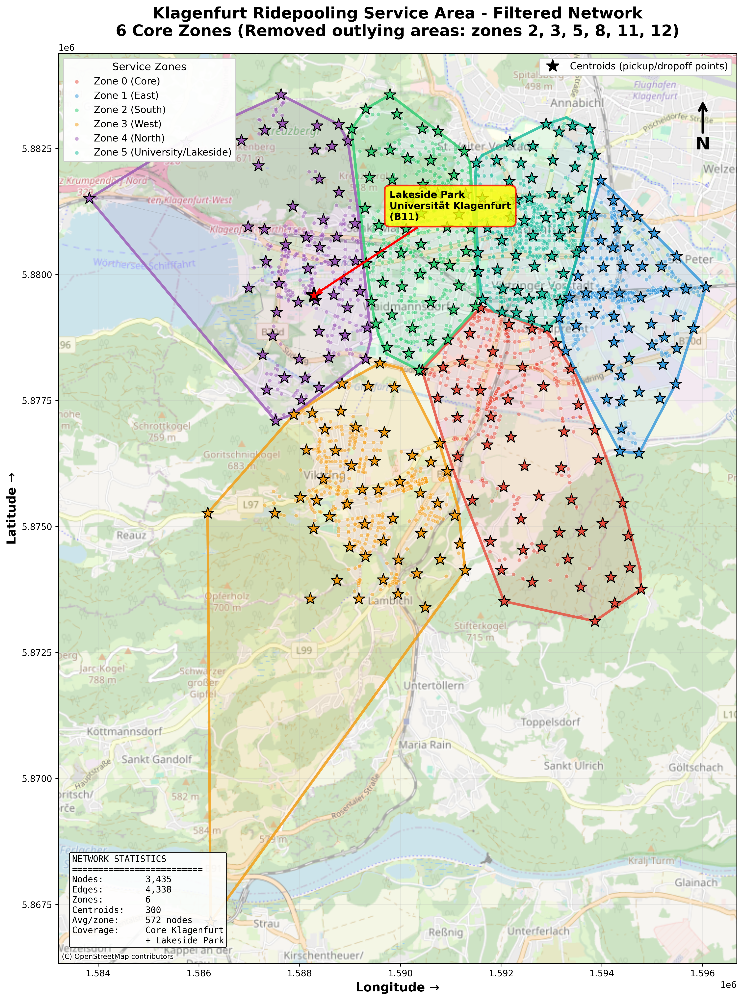

# 🚌 FleetPy Klagenfurt — Ridepooling-Simulationen

[](https://github.com/TUM-VT/FleetPy)
[](https://www.python.org/downloads/)

Dieses Repository enthält zwei unabhängige Vorhaben, die beide das [FleetPy](https://github.com/TUM-VT/FleetPy)-Simulationsframework für Ridepooling in Klagenfurt nutzen:

1. **FLIP-FLOP-Konsortialprojekt** (aktuell, siehe unten) — FFG-gefördert, Validierung einer KI-Nachfrageprognose gegen echte Betriebsdaten.
2. **8-Sitzer-Fallstudie** (abgeschlossen, kompakte Zusammenfassung weiter unten) — Machbarkeitsstudie für einen Ridepooling-Dienst mit Standard- und barrierefreien Fahrzeugen.

---

## 🆕 FLIP-FLOP-Konsortialprojekt: Ist die KI-Nachfrageprognose realistisch?

**Konsortium:** AIT Austrian Institute of Technology, DatenVorsprung, KMG Klagenfurt Mobil, pdcp/SURAAA, Stadt Klagenfurt, Tech Meets Legal.

**Die Frage:** FlipFlop (AIT) sagt per KI-Modell voraus, welche Personen bei einem On-Demand-Angebot (DRT) vom Auto/ÖV/Rad/Fuß umsteigen würden. Ist diese prognostizierte Nachfrage realistisch — und lässt sie sich mit FleetPy überhaupt sinnvoll bedienen?

**Die Methode:** FleetPy dient hier nicht nur als Fuhrpark-Simulator für die 8-Sitzer-Studie, sondern als **unabhängiges Validierungswerkzeug**: Die FlipFlop-Prognose wird gegen echte KMG/MOIA-Betriebsdaten benchmarkt — räumlich, mengenmäßig und operativ (simulierte Servicerate).

**Die Ergebnisse (Kurzfassung):**
| Check | Ergebnis |
|---|---|
| **Räumlich** — Entsteht die Nachfrage in denselben Stadtteilen wie echte Fahrten? | **0,86 Korrelation** zwischen FlipFlop-Prognose und echten KMG/MOIA-Fahrten über 8 Zonen |
| **Mengenmäßig** — Ist die Nachfragemenge plausibel? | FlipFlop sagt 3,3–23x mehr Nachfrage voraus als MOIA real realisiert — eine Untergrenze, kein Alarmsignal (echtes Warnsignal wäre *weniger* gewesen) |
| **Operativ** — Lässt sich das in FleetPy genauso gut bedienen wie echte Nachfrage? | Servicerate-Kurven von FlipFlop-Prognose und echter MOIA-Nachfrage sind bei gleicher Flottengröße **nahezu identisch** |

Ein unabhängiger Fund bestätigt zudem eine bereits von AIT beobachtete Modell-Eigenschaft: hohe Kostensensitivität, geringe Zeitsensitivität im Choice-Modell — zwei getrennte Methoden, ein übereinstimmendes Ergebnis.

**📌 Einstieg:** [`studies/flipflop_drt_integration_pilot/README.md`](studies/flipflop_drt_integration_pilot/README.md) → Abschnitt "Start here" → [`consortium_presentation_flipflop_validation.ipynb`](studies/flipflop_drt_integration_pilot/analysis/consortium_presentation_flipflop_validation.ipynb) (kurze Präsentationsfassung) bzw. [`flipflop_demand_model_validity.ipynb`](studies/flipflop_drt_integration_pilot/analysis/flipflop_demand_model_validity.ipynb) (vollständige Analyse).

---

## 8-Sitzer-Fallstudie Klagenfurt (abgeschlossen)

Machbarkeitsstudie für einen Ridepooling-Dienst in Klagenfurt mit **8-Sitzer Standard-** und **12-Sitzer barrierefreien Fahrzeugen**, Nachfolger einer früheren 4-Sitzer-Konsortiumstudie.

**💡 Zentrale Erkenntnis:** Trotz Verdopplung der Sitzplatzkapazität (4→8/12 Sitze) blieben die Serviceraten identisch — ein empirischer Beweis, dass **räumliche Abdeckung wichtiger ist als absolute Flottenkapazität**. Dieser Befund wiederholt sich in den H1-Ergebnissen unten (8-24 Fahrzeuge bringen bei 500 Anfragen über ein 6-Zonen-Gebiet kaum Verbesserung) und deckt sich mit dem, was die FLIP-FLOP-Analyse oben unabhängig über Pooling-Effizienz zeigt.

### Vier Teilstudien

| Studie | Fokus | Details |
|---|---|---|
| **H1** — Servicequalität | Flotten 20/30/40 Fahrzeuge, Maximierung Servicerate | [H1_service_quality.md](H1_service_quality.md) |
| **H2** — Minimale Flottengröße | Flotten 8/16/24/32, kritische Schwellenwerte | [H2_minimum_fleet.md](H2_minimum_fleet.md) |
| **UC2** — Digitale Kompetenz | Support-Maßnahmen für ältere Nutzer:innen | [UC2_age_based.md](UC2_age_based.md) |
| **UC3** — Barrierefreiheit | Flottenmix Standard/Gelenkbus, Rollstuhl/Kinderwagen | [UC3_accessibility.md](UC3_accessibility.md) |
| **Vergleich** 8- vs. 4-Sitzer | Validierung der Vorgängerstudie | [comparison_previous_study.md](comparison_previous_study.md) |

### Zentrale Ergebnisse (Filtered Network, 6 Zonen, 500 Anfragen über 16h)

| Flottengröße | Servicerate | Ø Wartezeit | Bedient/Gesamt |
|--------------|-------------|-------------|----------------|
| 8 Fahrzeuge  | 1,8% | 4,6 min | 9/500 |
| 16 Fahrzeuge | 1,8% | 4,6 min | 9/500 |
| 24 Fahrzeuge | 3,0% | 4,1 min | 15/500 |

Niedrige Serviceraten sind hier erwartungsgemäß: kleine Flotten über ein großflächiges 6-Zonen-Gebiet, ganztägiger Betrieb statt fokussierter Spitzenzeit. Eine frühere, spitzenzeit-fokussierte Konfiguration (100 Anfragen, 2h-Fenster) erreichte bei 24 Fahrzeugen 92% — die beiden Konfigurationen sind aufgrund unterschiedlicher Nachfragemenge/Zeitfenster **nicht direkt vergleichbar**. UC2/UC3-Simulationen mit dem gefilterten Netzwerk zeigen ähnlich niedrige Raten (<5%); für aussagekräftigere Ergebnisse wären größere Flotten (>50) oder ein fokussiertes Zeitfenster nötig. Volle Tabellen und Interpretation siehe die Studien-Dokumente oben.

### Netzwerk

Gefiltertes Kernnetzwerk: 3.435 Knoten, 6 Zonen (von ursprünglich 6.394 Knoten/12 Zonen gefiltert, Fokus auf Klagenfurt Stadtgebiet bis Lakeside Park). Setup, Scripts und vollständige Prozesskette: [data/networks/klagenfurt_h1_spitzenzeiten/README.md](data/networks/klagenfurt_h1_spitzenzeiten/README.md).



### Wissenschaftlicher Kontext: Hamburg-Studie (hvv hop vs. MOIA)

Empirische Daten aus Hamburg zeigen, dass Ridepooling-Dienste je nach Geschäftsmodell sehr unterschiedliche Rollen einnehmen können: **hvv hop** (öffentlich gefördert, ÖPNV-Zubringer, 70% intermodale Nutzung) vs. **MOIA** (eigenwirtschaftlich, Pkw-Alternative, nur 14% intermodal). Beim Wechsel von ioki Hamburg zu MOIA (2023) sank die Nachfrage insgesamt um 28%, mit überproportionalem Rückgang in Gebieten mit niedrigem sozioökonomischen Status — ein Hinweis, dass Tarifgestaltung entscheidend für inklusiven Zugang ist. **Für Klagenfurt:** UC2 (Ältere) und UC3 (Barrierefreiheit) adressieren genau diese Inklusivitätsfrage; öffentliche Förderung ist wahrscheinlich nötig, um die in H1 identifizierte Flottengröße wirtschaftlich zu betreiben. (Quelle: empirische Studie Gebiet Osdorf/Lurup, 2023.)

---

## Projekt-Setup

### Voraussetzungen
- Python 3.10+, Conda Environment

### Installation
```bash
git clone https://github.com/Createdd/fleet_hypothesistests.git
cd fleet_hypothesistests
conda env create -f environment.yml
conda activate fleetpy
```

### Simulationen ausführen (8-Sitzer-Studie)

```bash
# H1 (Servicequalität)
python run_klagenfurt_h1_spitzenzeiten.py
jupyter notebook studies/klagenfurt_h1_spitzenzeiten_case_study/analysis/klagenfurt_h1_spitzenzeiten_analysis.ipynb

# H2 (Minimale Flotte)
python run_klagenfurt_h2_spitzenzeiten.py
python studies/klagenfurt_h2_spitzenzeiten_case_study/klagenfurt_h2_spitzenzeiten_analysis.py

# UC2 (Digitale Kompetenz) — erzeugt 4 Szenarien (baseline, phone_support, simple_ui, full_support)
python run_uc2_age_based.py
jupyter notebook studies/uc2_age_based/analysis/uc2_analysis.ipynb

# UC3 (Barrierefreiheit) — erzeugt 4 Flottenzusammensetzungen (0/20/30/50% barrierefrei)
python run_uc3_accessibility.py
jupyter notebook studies/uc3_accessibility/analysis/uc3_analysis.ipynb
```

Für die FLIP-FLOP-Simulationen siehe [studies/flipflop_drt_integration_pilot/README.md](studies/flipflop_drt_integration_pilot/README.md).

### Service-Parameter (8-Sitzer-Studie)
- Max. Wartezeit: 8 min, max. Umwegfaktor: 40%, Einstiegszeit: 30-60s
- Fahrzeugkapazität: 8 Sitze (Standard), 12 Sitze (barrierefrei)
- Reoptimierungsintervall: 30s

---

## Glossar

- **Servicerate:** Anteil bedienter Anfragen an allen Anfragen
- **Wartezeit:** Zeit zwischen Anfrage und Abholung (Ø über bediente Anfragen)
- **Fahrzeugauslastung:** Anteil der Zeit, in der Fahrzeuge operativ genutzt werden

## Datenquellen
- **Netzwerkdaten:** OpenStreetMap Klagenfurt
- **Algorithmus:** Alonso-Mora et al. (2017), PNAS 114(3): 462-467
- **Framework:** [FleetPy](https://github.com/TUM-VT/FleetPy) (TUM München)
- **Vorherige Studie:** 4-Sitzer-Konsortiumstudie (AIT Austrian Institute of Technology)

## Lizenz
Dieses Projekt verwendet das FleetPy-Framework unter dessen Lizenz.
© Technische Universität München, Lehrstuhl für Verkehrstechnik

---

**Repository:** [github.com/Createdd/fleet_hypothesistests](https://github.com/Createdd/fleet_hypothesistests)
**Hinweis:** Diese Dokumentation wurde mithilfe von KI-Tools erstellt und unterstützt.
