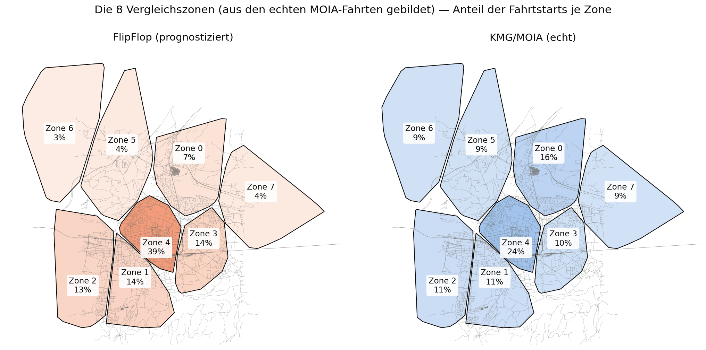

# 🚌 FLIP-FLOP × FleetPy — Plausibilitäts- und Konsistenzprüfung der KI-Nachfrageprognose für Klagenfurt

[](https://github.com/TUM-VT/FleetPy)
[](https://www.python.org/downloads/)

**Konsortium:** AIT Austrian Institute of Technology, DatenVorsprung, KMG Klagenfurt Mobil, pdcp/SURAAA, Stadt Klagenfurt, Tech Meets Legal (FFG-gefördert).

**Die Frage:** FlipFlop (AIT) sagt per KI-Modell voraus, welche Personen bei einem On-Demand-Angebot (DRT, bedarfsgesteuerter Ridepooling-Verkehr) vom Auto/ÖV/Rad/Fuß umsteigen würden. Ist diese prognostizierte Nachfrage realistisch — und lässt sie sich mit einer Fahrzeugflotte überhaupt sinnvoll bedienen?

**Die Methode:** Das [FleetPy](https://github.com/TUM-VT/FleetPy)-Simulationsframework (TUM) dient als **unabhängiges Prüfinstrument** in drei Dimensionen: räumliche und mengenmäßige Plausibilität der Prognose gegenüber echten KMG/MOIA-Fahrten, betriebliche Umsetzbarkeit (Flottenbedarf) und innere Konsistenz — liefert eine realistische Flotte die Bedienqualität, die FlipFlop bei der Prognose vorausgesetzt hat? Ob die prognostizierten Personen tatsächlich umsteigen, kann nur der reale Betrieb zeigen; die Simulation prüft die Voraussetzungen dafür.

## Ergebnisse (Kurzfassung)

| Prüfung | Befund | Was sich daraus ableiten lässt |
|---|---|---|
| **Räumlich** — Entsteht die prognostizierte Nachfrage dort, wo heute echte Fahrten stattfinden? | Die Verteilung der prognostizierten Fahrtstarts über <!--kf:zones:de0-->8<!--/kf--> Zonen stimmt mit den echten KMG/MOIA-Fahrten weitgehend überein (Korrelation <!--kf:zone_corr:de2-->0,87<!--/kf-->). Größte Abweichung im Stadtzentrum (Zone <!--kf:zone_max_divergence_id:de0-->4<!--/kf-->: <!--kf:zone_max_divergence_ff_pct:de0-->39<!--/kf--> % vs. <!--kf:zone_max_divergence_moia_pct:de0-->24<!--/kf--> %). | Das Modell bildet die räumliche Struktur der Nachfrage richtig ab. Die Zentrumsabweichung ist der eine Punkt, der mit AIT zu klären ist. |
| **Mengenmäßig** — Ist die prognostizierte Menge plausibel? | FlipFlop prognostiziert rund **<!--kf:ff_switchers_per_day_mean:de0~100-->2.600<!--/kf--> DRT-Wege pro Tag** im Bediengebiet; der heutige MOIA-Betrieb realisiert **<!--kf:moia_trips_per_day_min:de0~10-->100<!--/kf-->–<!--kf:moia_trips_per_day_max:de0~10-->260<!--/kf--> Fahrten pro Tag**. | Die Prognose beschreibt das Potenzial eines flächendeckenden Angebots zum ÖV-Tarif, nicht den heutigen Betrieb. Dass sie deutlich über der heute realisierten Nachfrage liegt, ist bei einem kleinen bestehenden Angebot zu erwarten; läge sie darunter, wäre das Modell unplausibel. |
| **Operativ** — Welche Flotte setzt die Prognose voraus? | Bei der vom Modell unterstellten Bedienqualität (Wartezeit ≤ ca. <!--kf:assumed_wait_min:de0-->6<!--/kf--> min) wird die heutige echte Nachfrage mit **<!--kf:moia_w6_largest_fleet_below_90:de0-->15<!--/kf-->–<!--kf:moia_w6_fleet_reaching_90:de0-->20<!--/kf--> Fahrzeugen** zu rund 90 % bedient (<!--kf:moia_w6_f15_served_pct:de0-->89<!--/kf-->–<!--kf:moia_w6_f20_served_pct:de0-->92<!--/kf--> %), die prognostizierte erst mit **rund <!--kf:ff_w6_fleet_closest_90:de0-->150<!--/kf--> Fahrzeugen** (<!--kf:ff_w6_closest_90_served_pct:de0-->90<!--/kf--> %; <!--kf:ff_w6_fleet_max:de0-->200<!--/kf--> Fahrzeuge: <!--kf:ff_w6_f200_served_pct:de0-->96<!--/kf--> %). Mit 20 Fahrzeugen werden nur <!--kf:ff_w6_f20_served_pct:de0-->37<!--/kf--> % bedient, mit 40 Fahrzeugen <!--kf:ff_w6_f40_served_pct:de0-->56<!--/kf--> %. (Bei üblichen Betriebsregeln, max. 8 min Wartezeit, reichen für die echte Nachfrage je nach Tag <!--kf:moia_implied_fleet_min:de0-->8<!--/kf-->–<!--kf:moia_implied_fleet_max:de0-->20<!--/kf--> Fahrzeuge.) Bei gleicher Auslastung je Fahrzeug ist die prognostizierte Nachfrage besser bündelbar als die heutige. | Die Prognose gilt nur zusammen mit einer entsprechend großen Flotte. Mit einer realistischen Flotte bekommt ein Teil der prognostizierten Umsteiger nicht die unterstellte Qualität und steigt im Modell nicht um — die tatsächlich erreichbare Nachfrage liegt also unter der Prognose. Wie weit darunter, ergibt eine Rückkopplung der erreichbaren Bedienqualität in das FlipFlop-Modell (nächster Schritt mit AIT). |

**Kurz:** Die Prognose ist räumlich richtig, mengenmäßig als Potenzial zu lesen und betrieblich gut bündelbar. Für die Dimensionierung eines realen Angebots sind Flottengröße und Nachfrage gemeinsam zu bestimmen; die simulierten Kennzahlen (Flotte, Bedienungsgrad, Wartezeiten je Szenario) liefern dafür die Grundlage. Annahmen: Bedienqualität aus der AIT-Modelldokumentation abgeleitet (Zugang = <!--kf:drt_access_share_pct:de0-->30<!--/kf--> % der ÖV-Zugangszeit), Bediengebiet = Gebiet der echten Fahrten, Flotte und Betriebszeitraum des MOIA-Betriebs lagen nicht vor.

Die 8 Vergleichszonen wurden per Clustering direkt aus den echten MOIA-Fahrten gebildet (keine Verwaltungsgrenzen). Zone <!--kf:zone_max_divergence_id:de0-->4<!--/kf--> ist das Stadtzentrum — dort weicht die Prognose am stärksten ab (<!--kf:zone_max_divergence_ff_pct:de0-->39<!--/kf--> % vs. <!--kf:zone_max_divergence_moia_pct:de0-->24<!--/kf--> % der Fahrtstarts):



Die geringe Umsteigequote (ÖV-Anteil im Bediengebiet <!--kf:pt_share_baseline_pct:de1-->11,6<!--/kf--> % → <!--kf:pt_share_drt_pct:de1-->13,0<!--/kf--> % im DRT-Szenario zum ÖV-Tarif, Mittel über <!--kf:ff_draws:de0-->5<!--/kf--> Ziehungen) deckt sich mit der von AIT selbst beobachteten hohen Kosten- und geringen Zeitsensitivität des Wahlmodells.

## 📌 Einstieg

1. **Konsistenzprüfung (operativ):** [`flipflop_consistency_test.ipynb`](studies/flipflop_drt_integration_pilot/analysis/flipflop_consistency_test.ipynb) — implizite MOIA-Flotte, Flottenbedarf der FlipFlop-Nachfrage, Verhalten bei gleicher Last
2. **Präsentationsfassung (kurz, alle drei Prüfungen):** [`consortium_presentation_flipflop_validation.ipynb`](studies/flipflop_drt_integration_pilot/analysis/consortium_presentation_flipflop_validation.ipynb)
3. **Räumliche und mengenmäßige Prüfung im Detail:** [`flipflop_demand_model_validity.ipynb`](studies/flipflop_drt_integration_pilot/analysis/flipflop_demand_model_validity.ipynb)
4. **Methodik, Skripte, Reproduktion, offene Punkte:** [`studies/flipflop_drt_integration_pilot/README.md`](studies/flipflop_drt_integration_pilot/README.md)

## Setup

```bash
git clone https://github.com/Createdd/fleet_hypothesistests.git
cd fleet_hypothesistests
conda env create -f environment.yml
conda activate fleetpy
(cd src/routing/cpp_router && python setup.py build_ext --inplace)   # C++-Router, einmalig; von den Simulationen benötigt
```

Die FlipFlop-Eingangsdaten (`data/SampleFiles_recovered/`, Modell-Draws von AIT) und die MOIA-Fahrtdaten (`data/demand/trips_klagenfurt.csv`) sind nicht Teil des Repos und müssen separat abgelegt werden. Alle Befehle zum Netzbau, zur Nachfrageaufbereitung und zu den Simulationsläufen stehen im [Studien-README](studies/flipflop_drt_integration_pilot/README.md).

## Validierung der Ergebnisse

Zuerst wird geprüft, ob das Repository lesbar ist: Jede versionierte Markdown-Datei und jedes Notebook wird wie auf GitHub gerendert, ohne sichtbare Markup-Reste und mit gültigen Links und Bildern. Danach wird jede Ergebniszahl in diesem README, im Studien-README, in den Notebook-Texten und im Kurzbericht automatisch gegen die Simulation geprüft. Die Kette lautet: Rohdaten → Netz und Nachfrage → <!--kf:sweep_runs_defined:de0-->135<!--/kf--> Simulationsläufe → Auswertung → [`key_figures.json`](studies/flipflop_drt_integration_pilot/results/key_figures.json) → zitierte Zahlen. In Markdown steht jede Zahl zwischen unsichtbaren HTML-Kommentar-Markierungen (Schema siehe [`check_claims.py`](studies/flipflop_drt_integration_pilot/check_claims.py)), die der Prüfer mit der berechneten Kennzahl vergleicht.

```bash
python studies/flipflop_drt_integration_pilot/validate_e2e.py                # schnell (~40 s): Lesbarkeit, Tests, Auswertung, Kennzahlen, Dokumente, Ergebnis-Manifest
python studies/flipflop_drt_integration_pilot/validate_e2e.py --level full   # vollständig (1,5–3 h): baut Netz und Nachfrage neu, simuliert alle Läufe neu, führt die Notebooks aus
git config core.hooksPath .githooks                                          # einmalig: schnelle Prüfung vor jedem Commit, der Studie, READMEs oder src/ betrifft
```

Ändern sich Daten, Code oder Szenarien gewollt, sind die Schritte im Kopf von [`validate_e2e.py`](studies/flipflop_drt_integration_pilot/validate_e2e.py) beschrieben. Zahlen werden nie von Hand nachgetragen, sondern mit `check_claims.py --update` aus den Kennzahlen übernommen; den umgebenden Text prüft man danach selbst.

## Weitere Inhalte

- **Frühere 8-Sitzer-Fallstudie (2025, H1/H2/UC2/UC3):** Machbarkeitsstudie mit 8-/12-Sitzer-Fahrzeugen, abgeschlossen; Ergebnisse wegen eines Netzwerkfehlers derzeit **unter Vorbehalt** → [studies/klagenfurt_8sitzer_studie/README.md](studies/klagenfurt_8sitzer_studie/README.md)
- **Framework:** `src/`, `run_examples.py` und die Beispielstudien in `studies/` (example_study, munich, manhattan, chicago, module_tests) stammen aus dem TUM-FleetPy-Upstream; Parameterreferenz in [Input_Parameters.md](Input_Parameters.md). Einzige lokale Änderung am Framework: CLI-Fix in `run_examples.py` (`sys.argv[1:]`).
- **Archiv:** abgelöste Skripte, Notebooks und README-Versionen in [archive/](archive/).
- **Berichtsunterlagen:** Einseiter für den Endbericht als Word-Datei: [FlipFlop_FleetPy_Kurzbericht_2026-11-25.docx](studies/flipflop_drt_integration_pilot/FlipFlop_FleetPy_Kurzbericht_2026-11-25.docx).

## Glossar

- **DRT:** Demand-Responsive Transport — bedarfsgesteuerter On-Demand-Verkehr ohne festen Fahrplan, hier als Ridepooling
- **Umsteiger (H-A):** Weg, der laut FlipFlop im Ist-Zustand nicht mit ÖV, bei DRT-Angebot zum ÖV-Tarif aber mit DRT zurückgelegt würde
- **Servicerate:** Anteil bedienter Anfragen an allen Anfragen
- **Wartezeit:** Zeit zwischen Anfrage und Abholung (Ø über bediente Anfragen)

## Datenquellen

- **Nachfrageprognose:** FlipFlop Mixed-Logit-Choice-Modell (AIT), <!--kf:ff_trips_per_draw:de0-->471.140<!--/kf--> kalibrierte Wege, <!--kf:ff_draws:de0-->5<!--/kf--> stochastische Draws je Szenario
- **Betriebsdaten:** MOIA-Fahrten Klagenfurt (<!--kf:moia_days:de0-->7<!--/kf--> Kalendertage), bereitgestellt über das Konsortium
- **Netzwerkdaten:** Graphenintegrations-Plattform (GIP, `data/gip_network_ogd.gpkg`) für die Konsistenzprüfung; OpenStreetMap für Karten und die frühere 8-Sitzer-Studie
- **Algorithmus:** Alonso-Mora et al. (2017), PNAS 114(3): 462-467
- **Optimierer:** HiGHS (Open Source, über scipy, keine Lizenz nötig); bis 21.11.2026 Gurobi. Wechsel und Vergleich beider Solver: [Studien-README, Abschnitt „Solver“](studies/flipflop_drt_integration_pilot/README.md#solver-highs-instead-of-gurobi-branch-highs-solver-since-2026-11-26)
- **Framework:** [FleetPy](https://github.com/TUM-VT/FleetPy) (TUM München)

## Lizenz
Dieses Projekt verwendet das FleetPy-Framework unter dessen Lizenz.
© Technische Universität München, Lehrstuhl für Verkehrstechnik

---

**Repository:** [github.com/Createdd/fleet_hypothesistests](https://github.com/Createdd/fleet_hypothesistests)
**Hinweis:** Diese Dokumentation wurde mithilfe von KI-Tools erstellt und unterstützt.
