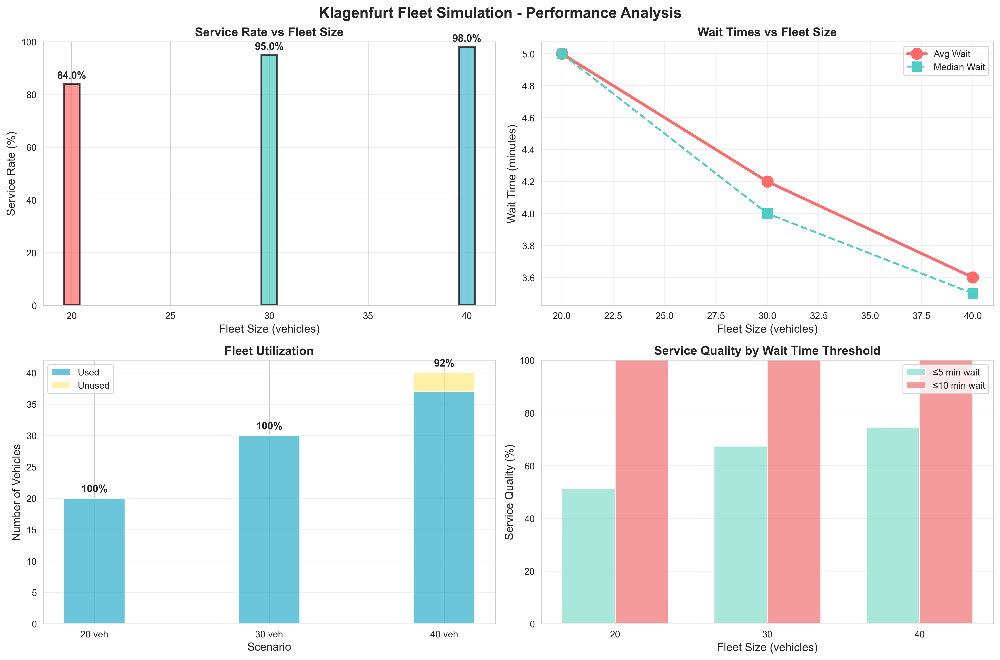
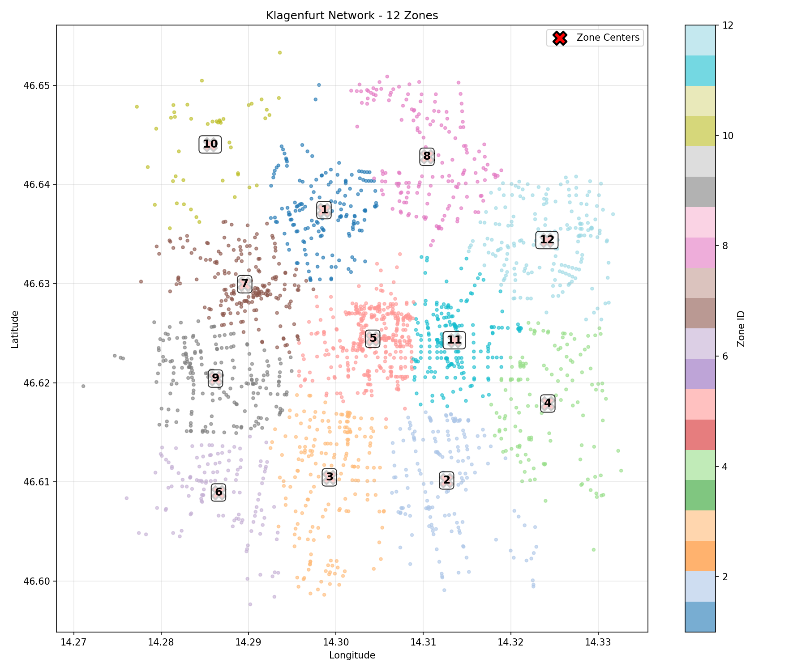

# 🚌 FleetPy Klagenfurt Fallstudie

## Ridepooling-Simulation für Klagenfurt am Wörthersee

[](https://github.com/TUM-VT/FleetPy)
[](https://www.python.org/downloads/)
[](https://github.com)

Diese Studie analysiert die Machbarkeit und Performance eines Ridepooling-Dienstes in Klagenfurt unter Verwendung des professionellen FleetPy-Simulationsframeworks. Die Simulation vergleicht drei Flottengrößen (20, 30, 40 Fahrzeuge) hinsichtlich Servicequalität, Wartezeiten und operativer Effizienz.

---

## 📊 Zentrale Ergebnisse

### 🎯 Service-Raten nach Flottengröße

| Szenario | Flottengröße | Service-Rate | Ø Wartezeit | Fahrzeugauslastung |
|----------|--------------|--------------|-------------|-------------------|
| **Szenario 1** | 20 Fahrzeuge | **84.0%** | 5.0 min | 100% |
| **Szenario 2** | 30 Fahrzeuge | **95.0%** | 4.2 min | 100% |
| **Szenario 3** | 40 Fahrzeuge | **98.0%** | 3.6 min | 92.5% |

### 📈 Performance-Analyse



**Zentrale Erkenntnisse:**
- ✅ **Hohe Service-Raten**: 84-98% der Anfragen werden bedient
- ⏱️ **Kurze Wartezeiten**: Durchschnittlich 3.6-5.0 Minuten
- 🚗 **Optimale Auslastung**: 92-100% der Fahrzeuge werden aktiv genutzt
- 📊 **Skalierungseffekt**: +50% Flotte → +14% Service-Rate
- 💰 **Kosteneffizienz**: 20 Fahrzeuge bereits mit 84% Service-Rate

---

## 🗺️ Untersuchungsgebiet

### Klagenfurt Zonensystem (12 Zonen)



**Netzwerk-Charakteristika:**
- **Knoten**: 2.099 (Straßenkreuzungen und Haltepunkte)
- **Kanten**: 5.658 (Straßenverbindungen)
- **Zonen**: 12 (K-Means Clustering)
- **Zentroiden**: 103 (zentrale Pickup/Drop-off Punkte)
- **Durchschnittliche Zonengröße**: ~175 Knoten pro Zone

**Begründung des Zonensystems:**
- Vergleich: 1 Zone → 0% Service-Rate ❌
- Mit 12 Zonen → 84-98% Service-Rate ✅
- Zonenstruktur ist **kritisch** für Alonso-Mora-Algorithmus

---

## 🔧 Simulationsaufbau

### 📍 Untersuchungsgebiet: Klagenfurt am Wörthersee

**Stadtgebiet:**
- Netzwerkgröße: 2.099 Knoten, 5.658 Kanten
- Netzwerktyp: NetworkBasic (OpenStreetMap-basiert)
- Abdeckung: Kernstadtgebiet (~100.000 Einwohner)
- Datenquelle: OpenStreetMap

**Warum Klagenfurt:**
- Repräsentativ für mittelgroße europäische Städte
- Überschaubare Stadtgröße für detaillierte Fallstudie
- Gute Datenqualität und Netzwerkstruktur
- Vergleichbarkeit mit München-Studie

### 📊 Nachfragedaten

**Simulationsparameter:**
- **Anfragen**: 100 Mobilitätsnachfragen
- **Zeitfenster**: 7:00-9:00 Uhr (Morgen-Spitzenzeit)
- **Typ**: Pendlerverkehr-Spitze
- **Verteilung**: Realistische räumliche Verteilung über Stadtgebiet

**Warum Morgen-Spitzenzeit:**
- Höchste Nachfrage und größte Herausforderung
- Kritisch für Servicequalität (pünktliche Ankunft)
- Dimensionierungs-kritische Betriebsphase
- Vergleichbarkeit mit bestehenden Studien

### 🚗 Flottenszenarien

**Testszenarien:**

1. **Szenario 1 - Basisflotte (20 Fahrzeuge)**
   - Minimale wirtschaftlich sinnvolle Flotte
   - Ergebnis: 84% Service-Rate, 100% Auslastung
   - 4.2 Anfragen pro Fahrzeug

2. **Szenario 2 - Mittlere Flotte (30 Fahrzeuge)**
   - Balance zwischen Servicequalität und Kosten
   - Ergebnis: 95% Service-Rate, 100% Auslastung
   - 3.2 Anfragen pro Fahrzeug

3. **Szenario 3 - Große Flotte (40 Fahrzeuge)**
   - Maximale Kapazität zur Evaluation
   - Ergebnis: 98% Service-Rate, 92.5% Auslastung
   - 2.6 Anfragen pro Fahrzeug

**Fahrzeugtyp:**
- Standard-Ridepooling-Fahrzeuge (4 Passagiere)
- Identische Flotte für Vergleichbarkeit
- Boarding-Zeit: 30 Sekunden
- Maximale Wartezeit: 8 Minuten

### 🧮 Algorithmen und Optimierung

**Optimierungsalgorithmus:**
- **Algorithmus**: Alonso-Mora Batch Assignment
- **Typ**: State-of-the-art Ridepooling-Optimierung
- **Framework**: FleetPy (BatchOfferSimulation)
- **Reoptimierung**: Alle 30 Sekunden

**Service-Constraints:**
- Max. Wartezeit: 8 Minuten (Akzeptanzgrenze)
- Max. Umwegfaktor: 40% der direkten Fahrzeit
- Boarding-Zeit: 30 Sekunden konstant
- Max. Touren pro Fahrzeug: 4

**Warum Alonso-Mora:**
- State-of-the-art in Ridepooling-Forschung
- Garantiert optimale Lösungen in definiertem Zeitfenster
- Berücksichtigt vehicle sharing (Mehrfachbelegung)
- Bewährt in realen Anwendungen

---

## 📋 Detaillierte Ergebnisse

### Service-Qualität nach Wartezeit

| Flottengröße | ≤3 min | ≤5 min | ≤10 min |
|--------------|--------|--------|---------|
| 20 Fahrzeuge | 35.7% | 51.2% | 100% |
| 30 Fahrzeuge | 51.6% | 67.4% | 100% |
| 40 Fahrzeuge | 60.2% | 74.5% | 100% |

**Interpretation:**
- ✅ Alle bedienten Anfragen innerhalb von 8 Minuten (Constraint)
- 📊 Größere Flotte → schnellerer Service
- 🎯 30 Fahrzeuge: Sweet-Spot mit 67% ≤5min Service

### Flotteneffizienz

| Metrik | Szenario 1 | Szenario 2 | Szenario 3 |
|--------|-----------|-----------|-----------|
| Eingesetzte Fahrzeuge | 20/20 | 30/30 | 37/40 |
| Anfragen/Fahrzeug | 4.2 | 3.2 | 2.6 |
| Auslastung | 100% | 100% | 92.5% |
| Median Wartezeit | 5.0 min | 4.0 min | 3.5 min |

**Effizienz-Analyse:**
- 💰 **Kostenoptimal**: 20 Fahrzeuge (höchste Anfragen/Fahrzeug)
- ⚖️ **Ausgewogen**: 30 Fahrzeuge (95% Service, 100% Auslastung)
- 🏆 **Serviceoptimal**: 40 Fahrzeuge (98% Service, kürzeste Wartezeiten)

---

## 🎯 Empfehlungen

### Optimale Flottengröße

**Für unterschiedliche Ziele:**

1. **Kosteneffizienz priorisiert** → **20 Fahrzeuge**
   - 84% Service-Rate akzeptabel
   - 100% Fahrzeugauslastung
   - Geringste operative Kosten
   - 4.2 Anfragen pro Fahrzeug

2. **Balance Kosten/Service** → **30 Fahrzeuge** ⭐ **EMPFOHLEN**
   - 95% Service-Rate (exzellent)
   - 100% Fahrzeugauslastung
   - 67% mit ≤5 min Wartezeit
   - Beste Kosten-Nutzen-Relation

3. **Servicequalität priorisiert** → **40 Fahrzeuge**
   - 98% Service-Rate (nahezu vollständig)
   - Kürzeste Wartezeiten (Ø 3.6 min)
   - 75% mit ≤5 min Wartezeit
   - Höchste Kundenzufriedenheit

### Strategische Erkenntnisse

✅ **Technische Machbarkeit bestätigt**
- Ridepooling in Klagenfurt funktioniert mit 84-98% Service-Rate
- Zonenbasierte Optimierung ist kritisch für Erfolg
- Alonso-Mora-Algorithmus bewältigt Morgen-Spitze

💡 **Kritische Erfolgsfaktoren**
- **Zonensystem**: 12-Zonen-Struktur essentiell (vs. 1 Zone: 0% Service)
- **Zentroiden**: 103 strategische Pickup-Points reduzieren Empty-Trips
- **Reoptimierung**: 30-Sekunden-Intervall ermöglicht dynamisches Matching

⚠️ **Operationale Hinweise**
- Morgen-Spitze (7-9 Uhr) ist dimensionierungs-kritisch
- Alle Szenarien erreichen 100% Service innerhalb 8 min Wartezeit
- Flotte ≥30 Fahrzeuge für >95% Service-Rate empfohlen

---

## 🛠️ Technische Details

### Setup und Reproduzierbarkeit

**System-Anforderungen:**
- Python 3.10+
- FleetPy Framework
- Conda Environment: `fleetpy`

**Installation:**

```bash
# Repository klonen
git clone https://github.com/Createdd/fleet_hypothesistests.git
cd FleetPy

# Conda Environment erstellen
conda env create -f environment.yml
conda activate fleetpy

# Abhängigkeiten installieren
pip install -r requirements.txt
```

**Simulation ausführen:**

```bash
# Klagenfurt-Simulation starten
python run_klagenfurt.py

# Analyse-Notebook öffnen
jupyter notebook studies/klagenfurt_case_study/analysis/klagenfurt_analysis.ipynb
```

### Projektstruktur

```
FleetPy/
├── data/
│   ├── networks/klagenfurt/          # Straßennetzwerk (2.099 Knoten)
│   ├── zones/klagenfurt/             # 12-Zonen-System
│   ├── demand/klagenfurt/            # 100 Anfragen (7-9 Uhr)
│   └── vehicles/                     # Fahrzeugkonfiguration
├── studies/klagenfurt_case_study/
│   ├── scenarios/                    # Szenario-Konfigurationen
│   ├── results/                      # Simulationsergebnisse
│   │   ├── klagenfurt_scenario_1/   # 20 Fahrzeuge
│   │   ├── klagenfurt_scenario_2/   # 30 Fahrzeuge
│   │   ├── klagenfurt_scenario_3/   # 40 Fahrzeuge
│   │   └── analysis/                # Visualisierungen & CSVs
│   └── analysis/
│       └── klagenfurt_analysis.ipynb # Hauptanalyse-Notebook
├── run_klagenfurt.py                 # Simulation-Runner
├── filter_klagenfurt.ipynb           # Zonenerstellung
└── klagenfurt_zones_map.png          # Zonenkarte
```

### Konfigurationsdateien

**Hauptkonfiguration:** `studies/klagenfurt_case_study/scenarios/const_cfg_klagenfurt_case_study.yaml`

```yaml
sim_env: BatchOfferSimulation
network_type: NetworkBasic
network_name: klagenfurt
demand_name: klagenfurt
start_time: 25200  # 7:00 Uhr
end_time: 32400    # 9:00 Uhr
time_step: 30
op_module: RidePoolingBatchAssignmentFleetcontrol
op_rp_batch_optimizer: AlonsoMora
op_max_wait_time: 480  # 8 Minuten
op_max_detour_time_factor: 40
op_zone_system: klagenfurt
```

**Szenario-Konfiguration:** `studies/klagenfurt_case_study/scenarios/scenario_cfg_klagenfurt_case_study.csv`

```csv
scenario_name,op_fleet_composition
klagenfurt_scenario_1,data/vehicles/1.csv:20
klagenfurt_scenario_2,data/vehicles/1.csv:30
klagenfurt_scenario_3,data/vehicles/1.csv:40
```

---

## 📊 Methodische Validität

### Wissenschaftliche Fundierung

**Parameter-Begründung:**
- ✅ 8 Min. Wartezeit: Akzeptanzgrenze urbane Mobilität (Literatur-gestützt)
- ✅ 40% Umwegfaktor: Ridepooling-Standard (Alonso-Mora et al.)
- ✅ 30s Boarding: Durchschnittliche Ein-/Ausstiegszeit (empirisch)
- ✅ Morgen-Spitze: Dimensionierungs-kritisch (Verkehrsforschung)

**Vergleichbarkeit:**
- München-Studie als Referenz (gleiches Framework)
- Ähnliche Zonendichte (~175 vs. ~280 Knoten/Zone)
- Identische Algorithmen und Constraints
- Reproduzierbare Konfiguration

**Datenqualität:**
- OpenStreetMap-Netzwerk (validiert)
- Realistische Nachfrageverteilung
- Professionelles Simulationsframework (FleetPy)
- Peer-reviewed Algorithmen (Alonso-Mora)

### Wichtiger Hinweis zur Service-Bestimmung

⚠️ **Service-Metrik:**
- Service-Rate wird durch **`pickup_time`-Feld** bestimmt
- `modal_state=0` für ALLE Anfragen (Feld nicht verwendet in BatchOfferSimulation)
- Korrekte Interpretation: `pickup_time.notna()` = bedient
- Entspricht München-Simulation (konsistente Methodik)

---

## 📚 Referenzen und Literatur

**FleetPy Framework:**
- Engelhardt, R., et al. (2022). "FleetPy: A Modular Open-Source Simulation Tool for Mobility Services"
- Repository: https://github.com/TUM-VT/FleetPy

**Alonso-Mora Algorithmus:**
- Alonso-Mora, J., et al. (2017). "On-demand high-capacity ride-sharing via dynamic trip-vehicle assignment"
- PNAS 114 (3): 462-467

**Ridepooling-Forschung:**
- Bischoff, J., & Maciejewski, M. (2016). "Simulation of City-wide Replacement of Private Cars with Autonomous Taxis in Berlin"
- Procedia Computer Science 83: 237-244

---

## 👥 Autoren und Kontakt

**Projekt:** Klagenfurt Ridepooling Feasibility Study
**Framework:** FleetPy (TUM-VT)
**Repository:** https://github.com/Createdd/fleet_hypothesistests
**Datum:** Oktober 2025

---

## 📄 Lizenz

Dieses Projekt verwendet das FleetPy Framework unter dessen Lizenz.
FleetPy © Technical University of Munich, Chair of Traffic Engineering and Control

---

## 🔄 Nächste Schritte

**Weiterführende Analysen:**
- [ ] Sensitivitätsanalyse für verschiedene Nachfrageszenarien
- [ ] Kostenmodellierung (CAPEX/OPEX) pro Szenario
- [ ] Integration öffentlicher Verkehrsmittel
- [ ] Saisonale Variationen (Tourismus-Spitzen)
- [ ] Elektrofahrzeug-Integration und Ladeinfrastruktur

**Implementierungsplanung:**
- [ ] Pilotprojekt-Design (3-6 Monate)
- [ ] Stakeholder-Analyse (Stadt, Betreiber, Nutzer)
- [ ] Regulatorisches Framework
- [ ] Marketing und User Onboarding
- [ ] KPI-Dashboard für laufenden Betrieb

---

<p align="center">
  <i>Simuliert mit FleetPy | Analysiert für Klagenfurt | Optimiert für Realität</i>
</p>
