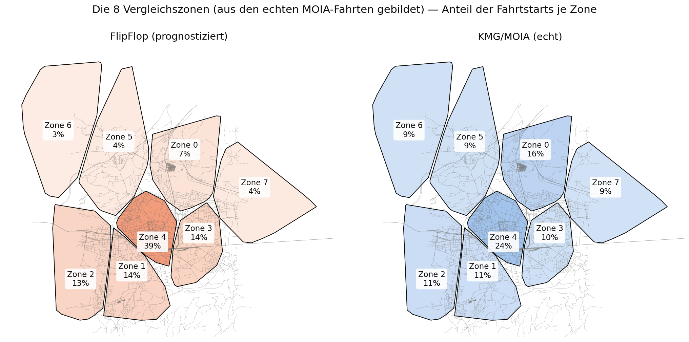

# FlipFlop DRT Integration Pilot

This study uses FleetPy's operational ridepooling simulation as an independent check of the FlipFlop (AIT) mode-choice prediction for Klagenfurt, benchmarked against real MOIA trips.

> ## 📌 Start here
>
> **[`analysis/flipflop_consistency_test.ipynb`](analysis/flipflop_consistency_test.ipynb)** is the primary result of this study: the operational consistency test — implied MOIA fleet, fleet needed for the FlipFlop demand at its assumed level of service, and behaviour at equal load. See "Current result" below for how to reproduce it.
>
> **[`analysis/consortium_presentation_flipflop_validation.ipynb`](analysis/consortium_presentation_flipflop_validation.ipynb)** is the short consortium-facing summary; sections 1–2 (spatial, volume) in detail, section 3 summarises the consistency test. It condenses **[`analysis/flipflop_demand_model_validity.ipynb`](analysis/flipflop_demand_model_validity.ipynb)**, which carries the detail for checks 1–2. Everything else in `analysis/` is earlier or supporting work kept for traceability — see the table below and "Earlier work" at the end of this file.

| Notebook | Status |
|---|---|
| `flipflop_consistency_test.ipynb` | **Current — primary result (operational consistency test)** |
| `consortium_presentation_flipflop_validation.ipynb` | Current — consortium summary of all three checks |
| `flipflop_demand_model_validity.ipynb` | Current for checks 1–2 (spatial, volume); its part 3 is superseded by the consistency test |
| `flipflop_drt_demand_construction.ipynb` | Supporting — how the H-A switcher definition was derived (still the basis of `prepare_demand_v2.py`) |
| `flipflop_vs_moia_klagenfurt_bounded_comparison.ipynb` | Supporting — spatial-only comparison, pre-dates the simulated checks |
| `flipflop_drt_feasibility_results.ipynb` | Historical — early H-A results on the previous network build |
| `flipflop_vs_moia_bounded_comparison.ipynb` | Historical — Neubau-track version, kept for reference only |
| ~~`flipflop_vs_moia_simulation_comparison.ipynb`~~ | Moved to [`archive/legacy_flipflop_pilot/`](../../archive/legacy_flipflop_pilot/) — can no longer be re-run |

The report one-pager for the consortium final report is [`FlipFlop_FleetPy_Kurzbericht_2026-11-14.docx`](FlipFlop_FleetPy_Kurzbericht_2026-11-14.docx).

## Current result: operational consistency test

**Question:** does a plausible fleet deliver the level of service FlipFlop *assumed* when predicting the demand?

**Setup** (all scripts in this folder; results under `results/v2_*` and `results/v2w6_*`, aggregated in `results/v2_evaluation.csv`):

| | earlier pipeline (see "Earlier work") | current |
|---|---|---|
| Network | 43k geometry vertices, 30 s floor | `build_gip_network.py`: official GIP link graph (`data/gip_network_ogd.gpkg`), 15,320 nodes / 34,125 directed edges, speeds and one-ways per direction from GIP, largest strongly connected component only; 34.5 km/h edge speed, 5 km beeline ≈ 9 min |
| Routing | NetworkBasic (pure Python) | `NetworkBasicWithStoreCpp` (build once: `cd src/routing/cpp_router && python setup.py build_ext --inplace`); a 2,700-request day takes ~2 min instead of hours |
| MOIA demand | 7 calendar days stacked, 06–22 h | `prepare_demand_v2.py`: one file per calendar day (102–249 routable requests out of 104–259 raw trips, 95–98 % routable), full day |
| FlipFlop demand | draw 1 | draws 1–5 (2,550–2,730 switchers/day each; the per-trip switch is a random realisation of a ~1.4 pp probability shift, so single draws are not meaningful) |
| Vehicle start | uniform over network | density of real MOIA origins (`moia_origin_density.csv`) |
| Runner | `run_examples.py` CLI / inline calls | `run_v2.py` (file-based entry point; inline `n_parallel_sim>1` silently loops forever on macOS) |

```bash
python studies/flipflop_drt_integration_pilot/build_gip_network.py
python studies/flipflop_drt_integration_pilot/prepare_demand_v2.py
python studies/flipflop_drt_integration_pilot/run_v2.py scenario_cfg_v2_sweep.csv --parallel 5 --skip-done        # 72 runs, ~20 min
python studies/flipflop_drt_integration_pilot/run_v2.py scenario_cfg_v2_sweep_wait6.csv --parallel 5 --skip-done  # 40 runs, ~7 min
python studies/flipflop_drt_integration_pilot/evaluate_v2.py --pattern 'v2*'
```

**Results** (`analysis/flipflop_consistency_test.ipynb`; assumed level of service = wait ≤ 6.3 min (AIT: DRT access = 30 % of Ø 21 min PT access) and in-vehicle time ≤ 1.4× direct — explicit assumptions until AIT supplies absolute values). Two operating configurations are simulated, and the fleet numbers differ between them:

- **standard** (`scenario_cfg_v2_sweep.csv`): usual operating rule, max. 8 min wait
- **assumed quality** (`scenario_cfg_v2_sweep_wait6.csv`, `op_max_wait_time = 378 s`): the service only accepts requests it can serve within the level of service FlipFlop assumed

1. **Implied MOIA fleet (standard config):** 8–20 vehicles (median 15 across the 7 calendar days) serve ≥ 90 % of each day's real trips. This is the calibration question for KMG: if their real fleet is in this range, the simulator is credible for Klagenfurt.
2. **FlipFlop fleet sizing:** in the standard config, 100 vehicles serve 90 % of the ~2,600 predicted switchers, but only 55 % within the assumed quality. In the assumed-quality config, 40 / 60 / 100 / 150 vehicles serve **54 / 63 / 77 / 89 %** of the predicted switchers; real MOIA demand in the same config: 8 / 10 / 15 / 20 vehicles → 73 / 79 / 89 / 92 %. **At equal service quality, ~90 % takes 15–20 vehicles for real demand and ~150 for the predicted demand.**
3. **Same load, same behaviour:** at equal requests per vehicle and day (overlap 25–62), FlipFlop demand is served *better* than real MOIA demand (86 % vs. 69 %) because it is spatially denser and pools more (detour 1.21 vs. 1.07); the share within the assumed quality is identical (49 % vs. 48 %). The predicted demand is therefore operationally at least as tractable as real demand — the pooling gap seen with the earlier network build does not persist.

**Bottom line:** the FlipFlop prediction is internally consistent only with a fleet of ~150 vehicles for Klagenfurt. With a fleet in the range KMG actually operates (tens of vehicles), roughly half of the predicted switchers would not receive the level of service the choice model assumed — the prediction is an upper bound and the equilibrium demand is lower.

## Checks 1–2: spatial and volume plausibility

Detail in `analysis/flipflop_demand_model_validity.ipynb` (parts 1–2), summarised in the consortium notebook.

1. **Spatial validation (zone-level, not bounding-box).** The existing `node_zone_info.csv` zone lookup belongs to a different, 3,435-node network, so it was not reusable by node ID. Instead, both FlipFlop switcher origins and real MOIA origins are joined directly against the real-coordinate zone polygons (`data/zones/klagenfurt_h1_spitzenzeiten/adapted_to_moia_data/moia_zone_polygons.geojson`, 8 zones built from MOIA's own trip clustering). Result: **correlation 0.86** between the two zone-share distributions — real spatial agreement, not just shared map coverage. The one notable divergence: Zone 4 (city centre) gets 38.7 % of FlipFlop's predicted switchers vs. 24.3 % of MOIA's real trips. 13 % of switcher origins fall outside the 8 MOIA-derived zones.
2. **Volume check, with explicit caveats.** `trips_klagenfurt.csv` spans **7 real calendar days** (104–259 trips/day). FlipFlop predicts ~2,600 switchers per day in the same area and operating day (draws 1–5), roughly an order of magnitude above the per-day real volume. This does not prove the model right or wrong: MOIA's volume is *realized* demand under MOIA's own operating constraints (small fleet, limited marketing) — a lower bound on latent demand, not a ceiling. The red flag would be FlipFlop predicting *less* than MOIA already realizes; that is not what happens here. (The validity notebook states the ratio as 3.3× against all 7 days pooled and 23× against the daily mean, based on draw 1 on the earlier network build.)

The zone system with both sources' zone shares is mapped in `results/flipflop_vs_moia_zone_map.png` (written by the consortium presentation notebook):



## Open points

1. **Calibrate the simulator against the real operation:** obtain KMG's fleet size, service hours, wait-time distribution and rejection rate for the data period and check them against the implied fleet (8–20 vehicles, standard config).
2. **Replace the assumed level of service with AIT's absolute per-trip values** (access minutes, in-vehicle time in the DRT scenarios); re-run `evaluate_v2.py` with the confirmed thresholds.
3. **Iterate once with AIT:** feed the level of service achieved at a realistic fleet back into the choice model and re-run the sweep on the resulting demand — this yields the equilibrium demand that the consistency test identifies as lower than the prediction.
4. **Price scenarios (H-B):** `prepare_demand_v2.py --price-scenarios DRT_Kostenx0.5 DRT_Kostenx2` and the same sweep, reported as ranges over draws.
5. Investigate the Zone 4 spatial divergence (38.7 % vs. 24.3 % of trip starts) and the 13 % of switcher origins outside the 8 MOIA-derived zones.

---

## Earlier work (superseded, kept for traceability)

Everything below documents how the study got to the current pipeline. The numbers in this section come from the earlier network build (`flipflop_neubau_extended`, 43k geometry vertices) and partly from a 07:00–09:00 window; **do not cite them as results** — use the sections above.

### Demand tracks

- **Neubau pilot** (`neubau/draws_Baseline.csv`, ~5,377 trips, `prepare_neubau_baseline_draw1.py`): scoped to a small area, produced very few MOIA-frame-and-network-covered rows; abandoned in favour of the whole-region model.
- **Klagenfurt all-mode pilot** (`full_draws/draws_Baseline.csv`, 471,140 calibrated trips, `prepare_klagenfurt_baseline_draw1.py`): ~22.8k candidate requests after filtering, capped at the first 100 in 07:00–09:00; every sampled mode (`Car`, `PT`, `Bike`, `Foot`) treated as a DRT request. A stress test, not a demand forecast.
- **Real MOIA trips** (`data/demand/trips_klagenfurt.csv`, `prepare_moia_klagenfurt_baseline.py`): simulated the same way for comparison; originally 07:00–09:00, later the full 06:00–22:00 day with all 7 calendar days stacked.
- **Hypothesis H-A, realistic mode-switchers** (`prepare_drt_switcher_demand.py`): a trip counts only if it is `PT` under `draws_DRT_Kostenx1.csv` (DRT at PT tariff) but not `PT` in `draws_Baseline.csv`; full day 06:00–22:00. This definition is what `prepare_demand_v2.py` uses today.

The two `*_baseline_draw1.py` scripts carry a deprecation note: they still have the connected-component defect described below, left unfixed so the historical numbers stay reproducible.

### Running the earlier pipeline

```bash
python studies/flipflop_drt_integration_pilot/build_flipflop_network.py

# Klagenfurt all-mode pilot and MOIA comparison (07:00-09:00)
python studies/flipflop_drt_integration_pilot/prepare_klagenfurt_baseline_draw1.py
python run_examples.py studies/flipflop_drt_integration_pilot/scenarios/const_cfg_flipflop_klagenfurt_pilot.yaml studies/flipflop_drt_integration_pilot/scenarios/scenario_cfg_flipflop_klagenfurt_pilot.csv
python studies/flipflop_drt_integration_pilot/prepare_moia_klagenfurt_baseline.py
python run_examples.py studies/flipflop_drt_integration_pilot/scenarios/const_cfg_moia_klagenfurt_pilot.yaml studies/flipflop_drt_integration_pilot/scenarios/scenario_cfg_moia_klagenfurt_pilot.csv

# H-A switchers on the earlier network
python studies/flipflop_drt_integration_pilot/prepare_drt_switcher_demand.py --price-scenario DRT_Kostenx1 --draw 1
python run_examples.py studies/flipflop_drt_integration_pilot/scenarios/const_cfg_flipflop_drt_feasibility.yaml studies/flipflop_drt_integration_pilot/scenarios/scenario_cfg_flipflop_drt_feasibility.csv
```

The Neubau configs (`const_cfg_flipflop_drt_integration_pilot.yaml`, `scenario_cfg_flipflop_drt_integration_pilot.csv`) still exist. All preparation scripts map coordinates to the nearest network node via a KD-tree (rejecting endpoints more than 0.005° away) and write to distinct demand names, so runs never overwrite each other. `python run_examples.py <const_cfg> <scenario_cfg>` requires this repo's CLI fix in `run_examples.py` (`sys.argv[1:]`).

### Spatial comparison maps

These plotting scripts still run and are independent of the simulation pipeline:

```bash
python studies/flipflop_drt_integration_pilot/plot_flipflop_vs_moia_origins_destinations.py              # results/flipflop_vs_moia_origins_destinations.png
python studies/flipflop_drt_integration_pilot/plot_flipflop_vs_moia_with_extended_street_network.py      # on klagenfurt_network_extended.gpkg
python studies/flipflop_drt_integration_pilot/plot_flipflop_vs_moia_with_openstreetmap.py                # results/flipflop_vs_moia_with_openstreetmap.png
```

Circles show origins, X markers destinations; blue is MOIA, orange is FlipFlop.

### All-mode stress test vs. MOIA (07:00–09:00)

Notebook archived at `archive/legacy_flipflop_pilot/flipflop_vs_moia_simulation_comparison.ipynb` (not re-runnable: the `moia_klagenfurt_baseline_30` result directory no longer exists). FlipFlop all-mode n=100 (~91 routable), MOIA n=49:

| Fleet | FlipFlop served | MOIA served |
|---|---|---|
| 20 | 5% | 2% |
| 30 | 10% | 2% |
| 40 | 11% | 4% |

Both sources landed in the same low service-rate range; absolute served counts were 1–11 requests, so the percentages were only indicative.

### H-A on the earlier network (`flipflop_drt_feasibility_results.ipynb`)

2,066 switcher requests (draw 1, MOIA frame, network-connected), full day:

| Fleet | Served | Service rate | Shared rides | Rides/vehicle |
|---|---|---|---|---|
| 20 | 76 | 3.7% | 74% | 3.80 |
| 40 | 148 | 7.2% | 76% | 3.70 |
| 60 | 226 | 10.9% | 75% | 3.77 |

Part 3 of `flipflop_demand_model_validity.ipynb` compared this with MOIA over the same full day (615 requests, all 7 days stacked): service rates 3.1–3.7 % / 7.2–7.3 % / 10.9–12.5 % at 20 / 40 / 60 vehicles, shared rides 74–76 % (H-A) vs. 13–21 % (MOIA). The low service rates were largely a property of that network build; the consistency test on the GIP network replaces this comparison and the pooling gap does not persist there.

### A routing bug found while building the H-A demand

Snapping a trip's endpoints to the nearest network node is not enough on its own: a node can be geometrically close but sit in a small, disconnected fragment of the street graph extracted from `klagenfurt_network_extended.gpkg`, so FleetPy can never route to or from it regardless of fleet size. 6,316 of that network's 43,137 nodes were outside the largest connected component. `prepare_drt_switcher_demand.py` and `prepare_moia_klagenfurt_baseline.py` filter against `data/fleetctrl/initial_vehicle_distribution/flipflop_neubau_extended/largest_component_uniform.csv`; the two `*_baseline_draw1.py` scripts do not. The GIP network of the current pipeline is restricted to its largest strongly connected component at build time, so the issue does not arise there.
