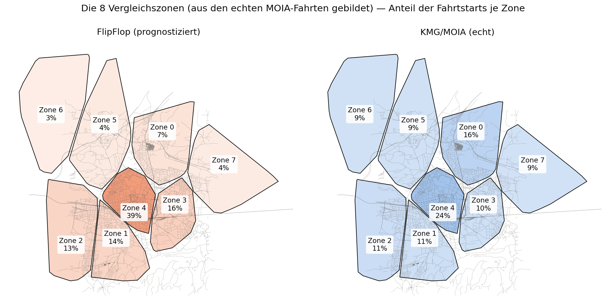

# FlipFlop DRT Integration Pilot

This study is the first bridge between the recovered FlipFlop mode-choice samples and FleetPy's operational ridepooling simulation.

> ## 📌 Start here
>
> **[`analysis/consortium_presentation_flipflop_validation.ipynb`](analysis/consortium_presentation_flipflop_validation.ipynb)** is the current, primary deliverable of this study — a short, visualization-led summary for the FLIP-FLOP consortium, written to prepare the "Meeting mit Christian (AIT DRC)" that Konsortial-Meeting 10 (22.09.2026) flagged as the required next step after simulating with realistic MOIA data. Open this one first.
>
> It condenses **[`analysis/flipflop_demand_model_validity.ipynb`](analysis/flipflop_demand_model_validity.ipynb)**, the full three-part validity check (spatial, volume, simulated performance) this summary is built on. Everything else in `analysis/` is earlier, superseded, or supporting work kept for traceability — see the table below.

| Notebook | Status |
|---|---|
| `consortium_presentation_flipflop_validation.ipynb` | **Current — present this one** |
| `flipflop_demand_model_validity.ipynb` | Current — full detail behind the summary above |
| `flipflop_drt_feasibility_results.ipynb` | Current — hypothesis H-A results (feeds into the validity check) |
| `flipflop_drt_demand_construction.ipynb` | Current — how the H-A demand was built and validated |
| `flipflop_vs_moia_simulation_comparison.ipynb` | Superseded by the validity check above (old all-modes demand, mismatched time window) |
| `flipflop_vs_moia_klagenfurt_bounded_comparison.ipynb` | Supporting — spatial-only comparison, pre-dates the simulated checks |
| `flipflop_vs_moia_bounded_comparison.ipynb` | Historical — Neubau-track version, kept for reference only |

The active track is the **Klagenfurt (whole-region) pilot**: sourced from the full regional model (`full_draws/draws_Baseline.csv`, 471,140 calibrated trips across all Klagenfurt/Ebenthal), restricted to the MOIA spatial frame and network coverage. This gives ~22.8k retained candidate requests after filtering, before the 100-row pilot cap.

An earlier **Neubau pilot** (sourced from the Neubau-specific model, `neubau/draws_Baseline.csv`, ~5,377 trips) is kept in this folder for reference but is not being actively run or extended — it was scoped to a small area and produced very few MOIA-frame-and-network-covered rows, which is why the work moved to the whole-region model instead.

A third demand source, **real MOIA trips** (`data/demand/trips_klagenfurt.csv`), is prepared and simulated the same way (`prepare_moia_klagenfurt_baseline.py`) so the FlipFlop-based pilot can be compared against actual observed demand on identical network/time-window/fleet-control settings. See "Simulated performance comparison" below.

A fourth, now-primary demand definition, **realistic DRT mode-switchers** (hypothesis H-A, `prepare_drt_switcher_demand.py`), replaced the "all modes" stress test below as the main line of work — see "Hypothesis H-A" further down for why and what it found.

## Pilot scope: all-mode stress test (superseded by hypothesis H-A, kept for the MOIA comparison above)

- Draw: `1` (later draws 2-5 to follow, see Next extensions)
- Time window: 07:00-09:00
- Request limit: first 100 rows ordered by departure time and `trip_id`, after common-frame and network-coverage filtering
- Users: all sampled modes (`Car`, `PT`, `Bike`, and `Foot`)
- Network: `flipflop_neubau_extended` (built from the full extended Klagenfurt network, despite the name — see below)
- Fleet scenarios: 20, 30, and 40 standard vehicles

The all-mode choice was intentional for this first pilot: it measures whether the network and fleet can handle the full sampled trip volume. It must not be interpreted as a behavioral prediction that every traveler requests DRT — hypothesis H-A below replaces this with FlipFlop's own prediction of who would actually switch to DRT.

## Run

From the repository root, build the shared pilot network first:

```bash
python studies/flipflop_drt_integration_pilot/build_flipflop_network.py
```

Then prepare demand and run the active track:

```bash
# Klagenfurt (whole-region) pilot, FlipFlop demand
python studies/flipflop_drt_integration_pilot/prepare_klagenfurt_baseline_draw1.py
python run_examples.py studies/flipflop_drt_integration_pilot/scenarios/const_cfg_flipflop_klagenfurt_pilot.yaml studies/flipflop_drt_integration_pilot/scenarios/scenario_cfg_flipflop_klagenfurt_pilot.csv

# Same network/window/fleet sizes, real MOIA demand (for comparison)
python studies/flipflop_drt_integration_pilot/prepare_moia_klagenfurt_baseline.py
python run_examples.py studies/flipflop_drt_integration_pilot/scenarios/const_cfg_moia_klagenfurt_pilot.yaml studies/flipflop_drt_integration_pilot/scenarios/scenario_cfg_moia_klagenfurt_pilot.csv
```

The Neubau pilot's own preparation script and scenario configs (`prepare_neubau_baseline_draw1.py`, `const_cfg_flipflop_drt_integration_pilot.yaml`, `scenario_cfg_flipflop_drt_integration_pilot.csv`) still exist and work but are no longer part of the active workflow.

Each preparation script keeps only trips whose endpoints are covered by the rebuilt `flipflop_neubau_extended` network (nearest-node distance under 0.005 degrees) — the FlipFlop scripts additionally restrict to the MOIA coordinate frame; the MOIA script doesn't need that filter since it *is* the frame's source. All three map coordinates to nearest network nodes via a KD-tree and write to distinct demand names (`flipflop_klagenfurt_pilot`, `flipflop_neubau_pilot`, `moia_klagenfurt_pilot`) so runs never overwrite each other. The network itself already covers the whole extended Klagenfurt area (43k+ nodes) — it was only named after the Neubau pilot that first used it. The builder also creates a vehicle initialization distribution over the largest connected component. Trips outside the network are rejected rather than silently assigned to distant nodes. The generated demand and simulation results are ignored by Git.

**Note:** `python run_examples.py <const_cfg> <scenario_cfg>` requires the fix in this repo's `run_examples.py` (`sys.argv[1:]` instead of `sys.argv` in the CLI dispatch) — without it, the upstream CLI entry point crashes because it passes the script's own path as the first scenario argument.

## Spatial comparison

To compare the FlipFlop Neubau points with the existing MOIA trips and FleetPy network nodes on the local street geometry:

```bash
python studies/flipflop_drt_integration_pilot/plot_flipflop_vs_moia_origins_destinations.py
```

This writes `results/flipflop_vs_moia_origins_destinations.png` in this study folder.

The extended street-network version uses the local `klagenfurt_network_extended.gpkg` without replacing the earlier figures:

```bash
python studies/flipflop_drt_integration_pilot/plot_flipflop_vs_moia_with_extended_street_network.py
```

The output is one large map: circles show origins, X markers show destinations; blue is MOIA and orange is FlipFlop.

The original local-street visualization is preserved. To additionally create the OpenStreetMap-backed version, run:

```bash
python studies/flipflop_drt_integration_pilot/plot_flipflop_vs_moia_with_openstreetmap.py
```

This writes `results/flipflop_vs_moia_with_openstreetmap.png` without overwriting the local-street image.

## Simulated performance comparison (all-mode stress test vs. MOIA)

`analysis/flipflop_vs_moia_simulation_comparison.ipynb` compares actual simulation output (not just spatial coverage) between the FlipFlop-Klagenfurt pilot (n=100, all-mode) and the real-MOIA pilot (n=49, 49 of 65 in-window trips retained after network-coverage filtering against the network's largest connected component), same network/window/fleet sizes throughout:

| Fleet | FlipFlop served | MOIA served |
|---|---|---|
| 20 | 5% | 2% |
| 30 | 10% | 2% |
| 40 | 11% | 4% |

Both sources land in the same low-single-digit-to-low-double-digit service rate range and show the same weak improvement with fleet size — the low service rate is not an artifact of using synthetic FlipFlop demand instead of real MOIA trips; it reflects the small-fleet-vs-whole-city-area constraint this study keeps finding elsewhere (H1/H2). Absolute served counts are small (1-11 requests), so treat exact percentages as indicative, not statistically robust. **Caveat:** the FlipFlop side of this comparison still uses the "all modes" demand (see below for why that was replaced) and the committed `prepare_klagenfurt_baseline_draw1.py` has not been updated with the largest-connected-component fix applied everywhere else in this study, so its n=100 denominator includes ~9 structurally unroutable requests (true denominator ~91).

**Historical snapshot, not reproducible as-is:** this notebook's MOIA side used the old 07:00-09:00 window (n=49). That window was later replaced with a full operating day (06:00-22:00) for a proper apples-to-apples comparison with H-A — see "FlipFlop demand model validity" below. The old `moia_klagenfurt_baseline_30` result directory this notebook reads no longer exists (the fleet-size sweep changed to 20/40/60 to match H-A), so re-running this specific notebook will fail; its stored output above remains an accurate record of what the 2-hour-window comparison showed at the time, it just is not the current or recommended comparison anymore.

## Hypothesis H-A: realistic DRT demand (mode-switchers, not "all modes")

"All modes" (every FlipFlop trip regardless of predicted mode) is a stress test, not a demand forecast — it measures whether the fleet survives everyone requesting DRT, not whether it serves the demand that would actually materialize. `prepare_drt_switcher_demand.py` rebuilds demand using FlipFlop's own mode-switcher definition instead: a trip counts only if it is `PT` under a DRT-priced scenario (`draws_DRT_Kostenx1.csv`, DRT at PT tariff) but was **not** `PT` in `draws_Baseline.csv`. It also runs over the full operating day (06:00-22:00, matching this repo's H1 convention) rather than the arbitrary 07:00-09:00 slice used above, and snaps only to the network's largest connected component (see "A routing bug" below).

```bash
python studies/flipflop_drt_integration_pilot/prepare_drt_switcher_demand.py --price-scenario DRT_Kostenx1 --draw 1
python run_examples.py studies/flipflop_drt_integration_pilot/scenarios/const_cfg_flipflop_drt_feasibility.yaml studies/flipflop_drt_integration_pilot/scenarios/scenario_cfg_flipflop_drt_feasibility.csv
```

This keeps 2,066 realistic requests (draw 1, MOIA frame, network-connected) out of 471,140 regional trips. Two notebooks document this:

- `analysis/flipflop_drt_demand_construction.ipynb` — builds and validates the demand definition: why the old time window and "all modes" choice were wrong (checked against MOIA's real hourly pattern, which is not morning-peaked), and the routing-connectivity bug found and fixed along the way.
- `analysis/flipflop_drt_feasibility_results.ipynb` — the actual H-A simulation results (fleets 20/40/60), compared directly against the all-mode stress test at matching fleet sizes:

| Fleet | Realistic switchers served | Service rate | Shared rides | Rides/vehicle |
|---|---|---|---|---|
| 20 | 76 | 3.7% | 74% | 3.80 |
| 40 | 148 | 7.2% | 76% | 3.70 |
| 60 | 226 | 10.9% | 75% | 3.77 |

Service rate is still modest, but realistic demand serves ~15x more absolute riders than the all-mode stress test at matching fleet sizes, with far more pooling (74-76% vs. 0-36%) — the switcher population is smaller but much more spatially/temporally clustered. Rides-per-vehicle stays flat (~3.7-3.8) from fleet 20 to 60, meaning this range has not yet hit diminishing returns: it does not yet locate a minimum viable fleet, it shows growth is still linear through 60 vehicles.

### A routing bug found while building this demand

Snapping a trip's endpoints to the nearest network node is not enough on its own: a node can be geometrically close but sit in a small, disconnected fragment of the street graph extracted from `klagenfurt_network_extended.gpkg`, so FleetPy can never route to or from it regardless of fleet size. The first version of this pipeline (and `prepare_klagenfurt_baseline_draw1.py` / `prepare_neubau_baseline_draw1.py`, still unfixed) only checked "does this node appear in some edge," not "is this node in the network's largest connected component." 6,316 of the network's 43,137 nodes fail that distinction. `prepare_drt_switcher_demand.py` and `prepare_moia_klagenfurt_baseline.py` now filter against `data/fleetctrl/initial_vehicle_distribution/flipflop_neubau_extended/largest_component_uniform.csv` (the same connected-component list the network builder already computes); both runs confirm zero `no route found` warnings.

## FlipFlop demand model validity: is it realistic, and is it drivable in FleetPy?

`analysis/flipflop_demand_model_validity.ipynb` answers this directly, benchmarked against real MOIA demand wherever possible, in three parts:

1. **Spatial validation (zone-level, not bounding-box).** The existing `node_zone_info.csv` zone lookup turned out to belong to a different, 3,435-node network than this pilot uses, so it was not reusable by node ID. Instead, both FlipFlop switcher origins and real MOIA origins are joined directly against the real-coordinate zone polygons (`data/zones/klagenfurt_h1_spitzenzeiten/adapted_to_moia_data/moia_zone_polygons.geojson`, 8 zones built from MOIA's own trip clustering). Result: **correlation 0.86** between the two zone-share distributions — real spatial agreement, not just shared map coverage. The one notable divergence: Zone 4 gets 38.7% of FlipFlop's predicted switchers vs. 24.3% of MOIA's real trips.
2. **Volume/magnitude check, with explicit caveats.** `trips_klagenfurt.csv` is not one day of MOIA demand — its `departure_time` values span **7 real calendar days** (104-259 trips/day), and every MOIA-based scenario in this repo folds all 7 into one simulated day. Against that pooled "one day," FlipFlop predicts **3.3x** more daily switcher demand in the same 06:00-22:00 window; against a true single-day average, **23x** more. Neither number alone proves the model right or wrong: MOIA's real volume is *realized* demand under MOIA's own operating constraints (small fleet, limited marketing) — a lower bound on latent demand, not a ceiling. The actual red flag to watch for would be FlipFlop predicting *less* than MOIA already realizes; that is not what happens here.
3. **Full-day simulated-performance comparison**, properly aligned this time: MOIA demand was rebuilt over the same 06:00-22:00 window as H-A (`prepare_moia_klagenfurt_baseline.py`, now 615 requests, zero `no route found` warnings) and simulated at the same fleet sizes (20/40/60). Service rate tracks closely between the two (3.1-3.7% at fleet 20, 7.2-7.3% at fleet 40, 10.9-12.5% at fleet 60) — far closer than the old, time-window-mismatched comparison ever showed, and the strongest plausibility evidence in this study. Pooling does not match as well: H-A stays flat at 74-76% shared rides regardless of fleet size, MOIA is lower and non-monotonic (13-21%) — FlipFlop's switcher population, all triggered by the same price scenario, is more spatially/temporally clustered than organic real-world demand, so it pools more easily even at a similar overall service rate.

The zone system itself, with both sources' zone shares, is mapped in `results/flipflop_vs_moia_zone_map.png` (written by the consortium presentation notebook; the street network underneath is the simulation network):



**Bottom line:** the FlipFlop-generated demand is spatially plausible (0.86 zone correlation), is not an under-estimate of real demand (it predicts more switching than MOIA realizes, not less), and is drivable in FleetPy at a service rate close to what real MOIA demand achieves under the same fleet — with the caveat that it pools somewhat more easily than real demand does.

## Interpretation

Compare service rate, waiting time, detours, and utilization across fleet sizes. Before expanding to all five draws or policy scenarios, validate the conversion summary printed by the preparation script, especially the number of requests retained and the nearest-node distance distribution.

## Next extensions

1. Extend the H-A fleet-size sweep upward (80/100/150+) to find where rides-per-vehicle starts to flatten - that inflection point is the real minimum-viable-fleet answer (H2-style). Apply the same wider sweep to the full-day MOIA comparison.
2. Test price sensitivity (H-B): rebuild demand from `draws_DRT_Kostenx0.5.csv` and `draws_DRT_Kostenx2.csv` and compare candidate-demand volume and required fleet size against the Kostenx1 baseline above.
3. Repeat H-A (and the full-day MOIA comparison) for Draws 2-5 to check draw-to-draw stability.
4. Investigate the Zone 4 spatial divergence and the pooling-rate gap found in the model-validity notebook - both are concrete, answerable follow-ups rather than open-ended uncertainty.
5. Backport the largest-connected-component fix to `prepare_klagenfurt_baseline_draw1.py` and `prepare_neubau_baseline_draw1.py` so the all-mode stress-test numbers above are no longer biased by ~9 structurally unroutable requests.