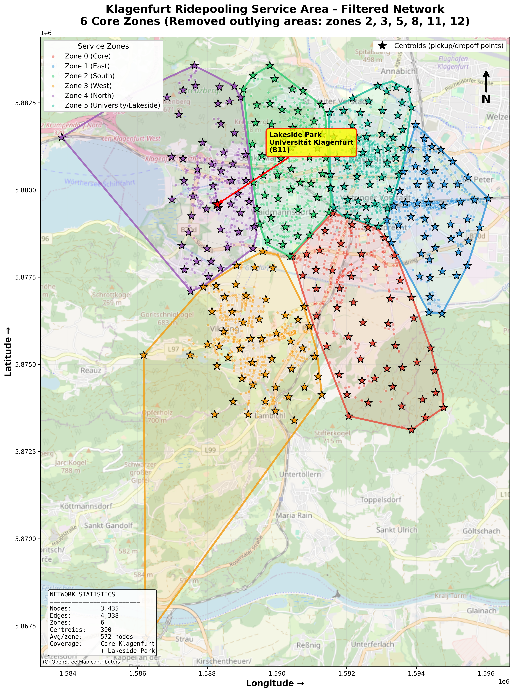

# 8-Sitzer-Fallstudie Klagenfurt (2025, abgeschlossen — Ergebnisse unter Vorbehalt)

Machbarkeitsstudie für einen Ridepooling-Dienst in Klagenfurt mit **8-Sitzer Standard-** und **12-Sitzer barrierefreien Fahrzeugen**, Nachfolger einer früheren 4-Sitzer-Konsortiumstudie (AIT). Dieser Ordner bündelt die Dokumentation und die Runner-Skripte der vier Teilstudien; die Szenarien und Ergebnisse selbst liegen weiterhin in den Studienordnern `studies/klagenfurt_h1_spitzenzeiten_case_study/`, `studies/klagenfurt_h2_spitzenzeiten_case_study/`, `studies/uc2_age_based/` und `studies/uc3_accessibility/`.

Die aktuelle Hauptarbeit des Repos — die FLIP-FLOP-Validierung — ist davon unabhängig und im [Root-README](../../README.md) beschrieben.

> ## ⚠️ Ergebnisse nicht belastbar — Netzwerkfehler
>
> Das Netz, auf dem alle vier Teilstudien gerechnet wurden (`data/networks/klagenfurt_h1_spitzenzeiten/base/`), ist seit der Erweiterung auf den Lakeside Park (Commit `83c701c`, 16.11.2025) fehlerhaft: Von 4.338 Kanten haben nur **28** eine Gegenrichtung, d. h. fast jede Straße ist nur in einer Richtung befahrbar. Die größte in beide Richtungen zusammenhängende Komponente umfasst **537 von 3.435 Knoten**, und nur **10 von 775 Anfragen** (1 %) haben Start *und* Ziel darin. Die anschließende Reduktion auf 6 Zonen (Commits `b96232b`/`b6542d4`) war ein Reparaturversuch am Symptom und hat das nicht behoben.
>
> **Konsequenz:** Die niedrigen Serviceraten unten (1,8–3,0 %), das identische Ergebnis bei 8 und 16 Fahrzeugen und die daraus abgeleitete „zentrale Erkenntnis“ (räumliche Abdeckung wichtiger als Kapazität) sind ein Artefakt des Netzes, kein Befund. Die Zahlen werden hier zur Nachvollziehbarkeit belassen, sollten aber **nicht zitiert oder weiterverwendet** werden, bis das Netz mit beiden Fahrtrichtungen neu gebaut und alle vier Studien neu gerechnet sind. Der Netzbau in `studies/flipflop_drt_integration_pilot/build_flipflop_network.py` zeigt, wie es richtig geht (jede Kante in beide Richtungen, Beschränkung auf die größte zusammenhängende Komponente).
>
> Die 92 %-Servicerate bei 24 Fahrzeugen, die [H1_service_quality.md](H1_service_quality.md) nennt, stammt vermutlich noch aus der Zeit des intakten 2.099-Knoten-Netzes (vor `83c701c`) und ist mit den Zahlen unten nicht vergleichbar.

## Vier Teilstudien

| Studie | Fokus | Details |
|---|---|---|
| **H1** — Servicequalität | Flotten 20/30/40 Fahrzeuge, Maximierung Servicerate | [H1_service_quality.md](H1_service_quality.md) |
| **H2** — Minimale Flottengröße | Flotten 8/16/24/32, kritische Schwellenwerte | [H2_minimum_fleet.md](H2_minimum_fleet.md) |
| **UC2** — Digitale Kompetenz | Support-Maßnahmen für ältere Nutzer:innen | [UC2_age_based.md](UC2_age_based.md) |
| **UC3** — Barrierefreiheit | Flottenmix Standard/Gelenkbus, Rollstuhl/Kinderwagen | [UC3_accessibility.md](UC3_accessibility.md) |
| **Vergleich** 8- vs. 4-Sitzer | Validierung der Vorgängerstudie | [comparison_previous_study.md](comparison_previous_study.md) |

## Ergebnisse (Filtered Network, 6 Zonen, 500 Anfragen über 16h) — siehe Vorbehalt oben

| Flottengröße | Servicerate | Ø Wartezeit | Bedient/Gesamt |
|--------------|-------------|-------------|----------------|
| 8 Fahrzeuge  | 1,8% | 4,6 min | 9/500 |
| 16 Fahrzeuge | 1,8% | 4,6 min | 9/500 |
| 24 Fahrzeuge | 3,0% | 4,1 min | 15/500 |

Die ursprüngliche Interpretation lautete: kleine Flotten über ein großflächiges 6-Zonen-Gebiet, ganztägiger Betrieb statt fokussierter Spitzenzeit. Eine frühere, spitzenzeit-fokussierte Konfiguration (100 Anfragen, 2h-Fenster) erreichte bei 24 Fahrzeugen 92 %; die beiden Konfigurationen sind aufgrund unterschiedlicher Nachfragemenge/Zeitfenster nicht direkt vergleichbar. UC2/UC3-Simulationen mit dem gefilterten Netzwerk zeigen ähnlich niedrige Raten (<5 %). Volle Tabellen und Interpretation siehe die Studien-Dokumente oben.

## Netzwerk

Gefiltertes Kernnetzwerk: 3.435 Knoten, 6 Zonen (von ursprünglich 6.394 Knoten/12 Zonen gefiltert, Fokus auf Klagenfurt Stadtgebiet bis Lakeside Park). Setup, Scripts und vollständige Prozesskette: [data/networks/klagenfurt_h1_spitzenzeiten/README.md](../../data/networks/klagenfurt_h1_spitzenzeiten/README.md). Die Reduktion auf 6 Zonen hat keine fachliche Grundlage (siehe Vorbehalt); nach der Netzkorrektur kann wieder mit allen 12 Zonen inklusive Lakeside Park gerechnet werden.



## Simulationen ausführen

Alle Skripte werden vom Repository-Root aus gestartet (Conda-Environment `fleetpy`, siehe Root-README):

```bash
# H1 (Servicequalität)
python studies/klagenfurt_8sitzer_studie/run_klagenfurt_h1_spitzenzeiten.py
jupyter notebook studies/klagenfurt_h1_spitzenzeiten_case_study/analysis/klagenfurt_h1_spitzenzeiten_analysis.ipynb

# H2 (Minimale Flotte)
python studies/klagenfurt_8sitzer_studie/run_klagenfurt_h2_spitzenzeiten.py
python studies/klagenfurt_h2_spitzenzeiten_case_study/klagenfurt_h2_spitzenzeiten_analysis.py

# UC2 (Digitale Kompetenz) — erzeugt 4 Szenarien (baseline, phone_support, simple_ui, full_support)
python studies/klagenfurt_8sitzer_studie/run_uc2_age_based.py
jupyter notebook studies/uc2_age_based/analysis/uc2_analysis.ipynb

# UC3 (Barrierefreiheit) — erzeugt 4 Flottenzusammensetzungen (0/20/30/50% barrierefrei)
python studies/klagenfurt_8sitzer_studie/run_uc3_accessibility.py
jupyter notebook studies/uc3_accessibility/analysis/uc3_analysis.ipynb

# MOIA-Minimalvarianten (Sensitivität)
python studies/klagenfurt_8sitzer_studie/run_moia_minimal_variants.py
```

Die Runner unterstützen `--track baseline` (synthetische Nachfrage) und `--track trips` (aus MOIA-Fahrten abgeleitete Nachfrage); Details in [EXPERIMENT_TRACKS.md](EXPERIMENT_TRACKS.md). Die studienübergreifende Auswertung liegt in [`studies/CROSS_HYPOTHESIS_RESULTS_ANALYSIS.ipynb`](../CROSS_HYPOTHESIS_RESULTS_ANALYSIS.ipynb).

### Service-Parameter
- Max. Wartezeit: 8 min, max. Umwegfaktor: 40 %, Einstiegszeit: 30–60 s
- Fahrzeugkapazität: 8 Sitze (Standard), 12 Sitze (barrierefrei)
- Reoptimierungsintervall: 30 s

## Wissenschaftlicher Kontext: Hamburg-Studie (hvv hop vs. MOIA)

Empirische Daten aus Hamburg zeigen, dass Ridepooling-Dienste je nach Geschäftsmodell sehr unterschiedliche Rollen einnehmen können: **hvv hop** (öffentlich gefördert, ÖPNV-Zubringer, 70 % intermodale Nutzung) vs. **MOIA** (eigenwirtschaftlich, Pkw-Alternative, nur 14 % intermodal). Beim Wechsel von ioki Hamburg zu MOIA (2023) sank die Nachfrage insgesamt um 28 %, mit überproportionalem Rückgang in Gebieten mit niedrigem sozioökonomischen Status — ein Hinweis, dass Tarifgestaltung entscheidend für inklusiven Zugang ist. **Für Klagenfurt:** UC2 (Ältere) und UC3 (Barrierefreiheit) adressieren genau diese Inklusivitätsfrage; öffentliche Förderung ist wahrscheinlich nötig, um die in H1 identifizierte Flottengröße wirtschaftlich zu betreiben. (Quelle: empirische Studie Gebiet Osdorf/Lurup, 2023.)
